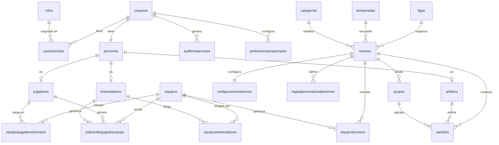

# DATABASE_SCHEMA.md — ControlTorneosFutbol

> Esquema completo de la base de datos PostgreSQL. Schema: `public`.
> Convención: todas las columnas y constraints en **minúsculas** (EF convention `.ToLower()`).

---

## 1. Convenciones de Nomenclatura

| Elemento | Convención | Ejemplo |
|---------|-----------|---------|
| Tablas | snake_case plural | `usuarios`, `equipostorneos` |
| Columnas | sin separadores, lowercase | `fechacreacion`, `equipolocalid` |
| PKs | `id` (int o uuid según tabla) | `id` |
| FKs | `{entidad}id` | `torneoid`, `usuarioid` |
| Índices únicos | `ix_{tabla}_{columna}` | `ix_usuarios_email` |
| PKs name | `pk_{tabla}` | `pk_usuarios` |
| FK constraints | `fk_{tabla}_{ref}_{col}` | `fk_partidos_equipos_equipolocalid` |

---

## 2. Diagrama ER (Mermaid)



---

## 3. Definición de Tablas

### `usuarios`
| Columna | Tipo | Nullable | Default | Notas |
|---------|------|----------|---------|-------|
| `id` | `uuid` | NO | `gen_random_uuid()` | PK |
| `email` | `varchar(256)` | NO | — | UNIQUE |
| `emailconfirmado` | `boolean` | NO | `false` | — |
| `passwordhash` | `text` | NO | — | BCrypt hash |
| `nombreusuario` | `text` | YES | — | Temporal: email.Split('@')[0] |
| `telefononomero` | `text` | YES | — | — |
| `telefonoconfirmado` | `boolean` | NO | `false` | — |
| `autenticaciondosfactores` | `boolean` | NO | `false` | No implementado |
| `fechabloquefin` | `timestamp` | YES | — | Lockout end time |
| `bloqueohabilitado` | `boolean` | NO | `true` | — |
| `contadoraccesosfallidos` | `int` | NO | `0` | Reset en login exitoso |
| `fechacreacion` | `timestamp` | NO | `NOW()` | — |
| `fechaactualizacion` | `timestamp` | YES | — | — |
| `activo` | `boolean` | NO | `true` | Soft delete |

### `roles`
| Columna | Tipo | Nullable | Notas |
|---------|------|----------|-------|
| `id` | `int` | NO | PK, SERIAL |
| `nombre` | `varchar(50)` | NO | UNIQUE |

> Valores seeded: `Administrador`, `Espectador`, `Jugador`, `Entrenador`, `Arbitro`

### `usuariosroles`
| Columna | Tipo | Nullable | Notas |
|---------|------|----------|-------|
| `id` | `int` | NO | PK, SERIAL |
| `usuarioid` | `uuid` | NO | FK → usuarios.id |
| `rolid` | `int` | NO | FK → roles.id |

> UNIQUE(usuarioid, rolid)

### `personas`
| Columna | Tipo | Nullable | Notas |
|---------|------|----------|-------|
| `id` | `uuid` | NO | PK |
| `usuarioid` | `uuid` | NO | FK → usuarios.id CASCADE |
| `nombre` | `varchar(100)` | NO | — |
| `apellidopaterno` | `varchar(100)` | NO | — |
| `apellidomaterno` | `varchar(100)` | YES | — |
| `fechanacimiento` | `timestamp` | YES | — |
| `dui` | `text` | YES | AES-256 encriptado |
| `telefono` | `varchar(20)` | YES | — |
| `activo` | `boolean` | NO | `true` |

### `jugadores`
| Columna | Tipo | Nullable | Notas |
|---------|------|----------|-------|
| `id` | `int` | NO | PK, SERIAL |
| `personaid` | `uuid` | NO | FK → personas.id, UNIQUE |
| `posicionpreferida` | `text` | YES | Portero/Defensa/Medio/Delantero |
| `numerocamiseta` | `int` | YES | — |
| `peso` | `decimal` | YES | kg |
| `altura` | `decimal` | YES | metros |

### `entrenadores`
| Columna | Tipo | Nullable | Notas |
|---------|------|----------|-------|
| `id` | `int` | NO | PK, SERIAL |
| `personaid` | `uuid` | NO | FK → personas.id, UNIQUE |

### `arbitros`
| Columna | Tipo | Nullable | Notas |
|---------|------|----------|-------|
| `id` | `int` | NO | PK, SERIAL |
| `personaid` | `uuid` | NO | FK → personas.id, UNIQUE |
| `numerolicencia` | `varchar(50)` | NO | UNIQUE |
| `categoriasarbitra` | `text` | YES | JSON array: ["Juvenil","Amateur",...] |
| `estadoaprobacion` | `text` | NO | `Pendiente`/`Aprobado`/`Rechazado`/`Suspendido` |
| `fechaaprobacion` | `timestamp` | YES | — |

### `ligas`
| Columna | Tipo | Nullable | Notas |
|---------|------|----------|-------|
| `id` | `int` | NO | PK, SERIAL |
| `nombre` | `varchar(100)` | NO | UNIQUE |

### `temporadas`
| Columna | Tipo | Nullable | Notas |
|---------|------|----------|-------|
| `id` | `int` | NO | PK, SERIAL |
| `nombre` | `varchar(50)` | NO | — |
| `anio` | `int` | NO | — |

> UNIQUE(nombre, anio)

### `categorias`
| Columna | Tipo | Nullable | Notas |
|---------|------|----------|-------|
| `id` | `int` | NO | PK, SERIAL |
| `nombre` | `varchar(50)` | NO | UNIQUE |

> Valores: Sub-15, Sub-17, Sub-20, Amateur, Profesional

### `torneos`
| Columna | Tipo | Nullable | Default | Notas |
|---------|------|----------|---------|-------|
| `id` | `int` | NO | SERIAL | PK |
| `ligaid` | `int` | NO | — | FK → ligas.id |
| `temporadaid` | `int` | NO | — | FK → temporadas.id |
| `categoriaid` | `int` | NO | — | FK → categorias.id |
| `nombre` | `varchar(150)` | NO | — | — |
| `formato` | `varchar(30)` | NO | — | TodosContraTodos/EliminacionDirecta/GruposYEliminacion |
| `estado` | `varchar(20)` | NO | `Borrador` | Borrador/Activo/Finalizado |
| `fechainicio` | `timestamp` | NO | — | — |
| `fechafin` | `timestamp` | NO | — | — |
| `numeroequiposmaximo` | `int` | YES | — | — |
| `numeroequiposminimo` | `int` | NO | `2` | — |
| `fechacreacion` | `timestamp` | NO | NOW() | — |
| `fechaactualizacion` | `timestamp` | YES | — | — |

### `configuracionestorneo`
| Columna | Tipo | Default | Notas |
|---------|------|---------|-------|
| `id` | `int` | SERIAL | PK |
| `torneoid` | `int` | — | FK → torneos.id, UNIQUE |
| `puntosporvictoria` | `int` | `3` | — |
| `puntosporempate` | `int` | `1` | — |
| `puntosporderrota` | `int` | `0` | — |
| `criteriodesempate1` | `text` | `Puntos` | — |
| `criteriodesempate2` | `text` | `DiferenciaGoles` | — |
| `criteriodesempate3` | `text` | `GolesFavor` | — |
| `criteriodesempate4` | `text` | `ResultadoDirecto` | — |
| `tarjetasamarillasparasuspension` | `int` | `3` | — |
| `partidossuspensiontarjetaroja` | `int` | `2` | — |
| `maximojugadoresconvocados` | `int` | `18` | — |
| `minimojugadorestitulares` | `int` | `11` | Usado en verificación pre-partido |

### `grupos`
| Columna | Tipo | Nullable | Notas |
|---------|------|----------|-------|
| `id` | `int` | NO | PK, SERIAL |
| `torneoid` | `int` | NO | FK → torneos.id |
| `nombre` | `varchar(50)` | NO | "Grupo A", "Grupo B", etc. |

### `equipos`
| Columna | Tipo | Nullable | Notas |
|---------|------|----------|-------|
| `id` | `int` | NO | PK, SERIAL |
| `nombre` | `varchar(100)` | NO | UNIQUE |
| `abreviacion` | `varchar(3)` | YES | 3 letras, e.g. "MAD" |
| `logo` | `text` | YES | Ruta relativa: `/uploads/logos/xxx.png` |
| `colorprimario` | `text` | YES | Hex color |
| `colorsecundario` | `text` | YES | Hex color |
| `sede` | `text` | YES | Nombre del estadio/cancha |
| `fechafundacion` | `timestamp` | YES | — |
| `fechacreacion` | `timestamp` | NO | NOW() |
| `activo` | `boolean` | NO | `true` |

### `equipostorneos`
| Columna | Tipo | Nullable | Notas |
|---------|------|----------|-------|
| `id` | `int` | NO | PK, SERIAL |
| `equipoid` | `int` | NO | FK → equipos.id |
| `torneoid` | `int` | NO | FK → torneos.id |
| `grupoid` | `int` | YES | FK → grupos.id |
| `fechainscripcion` | `timestamp` | YES | — |

> UNIQUE(equipoid, torneoid)

### `equiposentrenadores`
| Columna | Tipo | Nullable | Notas |
|---------|------|----------|-------|
| `id` | `int` | NO | PK, SERIAL |
| `equipoid` | `int` | NO | FK → equipos.id |
| `entrenadorid` | `int` | NO | FK → entrenadores.id |
| `fechaasignacion` | `timestamp` | YES | — |

### `equiposjugadorestorneos`
| Columna | Tipo | Nullable | Notas |
|---------|------|----------|-------|
| `id` | `int` | NO | PK, SERIAL |
| `equipoid` | `int` | NO | FK → equipos.id |
| `jugadorid` | `int` | NO | FK → jugadores.id |
| `torneoid` | `int` | NO | FK → torneos.id |
| `numerocamiseta` | `int` | YES | — |
| `activo` | `boolean` | NO | `true` |
| `fechainscripcion` | `timestamp` | NO | NOW() |

> UNIQUE(jugadorid, torneoid) — un jugador por torneo
> UNIQUE(equipoid, torneoid, numerocamiseta) — número único en equipo+torneo

### `solicitudesjugadorequipo`
| Columna | Tipo | Nullable | Default | Notas |
|---------|------|----------|---------|-------|
| `id` | `int` | NO | SERIAL | PK |
| `jugadorid` | `int` | NO | — | FK → jugadores.id CASCADE |
| `equipoid` | `int` | NO | — | FK → equipos.id CASCADE |
| `torneoid` | `int` | YES | — | FK → torneos.id CASCADE |
| `mensajejugador` | `text` | YES | — | — |
| `estado` | `text` | NO | `Pendiente` | Pendiente/Aceptada/Rechazada |
| `fechasolicitud` | `timestamp` | NO | NOW() | — |
| `fecharespuesta` | `timestamp` | YES | — | — |
| `respuestaentrenador` | `text` | YES | — | — |
| `entrenadorresponsableid` | `int` | YES | — | FK → entrenadores.id SET NULL |
| `esinvitacion` | `boolean` | NO | `false` | true=invitación coach, false=solicitud jugador |

### `personas`
> Columnas **añadidas en Sprint 4** (migración `Sprint4_5_ConvocatoriasReportesNotificaciones`):

| Columna | Tipo | Nullable | Notas |
|---------|------|----------|-------|
| `genero` | `varchar(20)` | YES | `Masculino` / `Femenino` / `Otro` |

### `equipos`
> Columna **añadida en Sprint 4**:

| Columna | Tipo | Nullable | Default | Notas |
|---------|------|----------|---------|-------|
| `tipoequipo` | `varchar(20)` | NO | `Libre` | `Libre`/`Masculino`/`Femenino`/`Juvenil`/`Amateur`/`Veterano` |

### `partidos`
| Columna | Tipo | Nullable | Default | Notas |
|---------|------|----------|---------|-------|
| `id` | `int` | NO | SERIAL | PK |
| `torneoid` | `int` | NO | — | FK → torneos.id CASCADE |
| `grupoid` | `int` | YES | — | FK → grupos.id SET NULL |
| `equipolocalid` | `int` | NO | — | FK → equipos.id RESTRICT |
| `equipovisitanteid` | `int` | NO | — | FK → equipos.id RESTRICT |
| `arbitroid` | `int` | YES | — | FK → arbitros.id SET NULL |
| `fecha` | `timestamp` | NO | — | Fecha y hora del partido |
| `sede` | `varchar(200)` | YES | — | — |
| `estado` | `varchar(20)` | NO | `Programado` | Programado/EnCurso/Finalizado/Cancelado/**Reprogramado** |
| `goleslocal` | `int` | YES | — | NULL hasta que finalice |
| `golesvisitante` | `int` | YES | — | NULL hasta que finalice |
| `minutoactual` | `int` | YES | — | Minuto en curso (Sprint 4) |
| `fechainicioreal` | `timestamp` | YES | — | Cuando árbitro presiona "Iniciar" (Sprint 4) |
| `razonreprogramacion` | `text` | YES | — | Motivo si estado = Reprogramado (Sprint 4) |
| `fase` | `varchar(50)` | YES | — | Fase del torneo (grupos, eliminatoria) |
| `jornada` | `int` | YES | — | Número de jornada |
| `fechacreacion` | `timestamp` | NO | NOW() | — |
| `fechaactualizacion` | `timestamp` | YES | — | — |

> Índice compuesto: `(torneoid, fecha)` para queries de calendario

### `reglaspersonalizadastorneo`
| Columna | Tipo | Nullable | Notas |
|---------|------|----------|-------|
| `id` | `int` | NO | PK, SERIAL |
| `torneoid` | `int` | NO | FK → torneos.id CASCADE |
| `nombre` | `varchar(200)` | NO | — |
| `descripcion` | `varchar(500)` | NO | — |
| `tipo` | `varchar(50)` | NO | — |
| `orden` | `int` | NO | Posición en lista |
| `activo` | `boolean` | NO | `true` |

### `auditoriaaccesos`
| Columna | Tipo | Nullable | Notas |
|---------|------|----------|-------|
| `id` | `int` | NO | PK, SERIAL |
| `usuarioid` | `uuid` | YES | FK → usuarios.id SET NULL |
| `email` | `varchar(256)` | YES | Guardado por si usuario se elimina |
| `accion` | `text` | NO | Login/LoginFallido/Logout/Bloqueo |
| `resultado` | `text` | NO | Exitoso/Fallido |
| `ipaddress` | `text` | YES | — |
| `useragent` | `text` | YES | — |
| `detalles` | `text` | YES | — |
| `fechaacceso` | `timestamp` | NO | NOW() |

### `convocatorias` *(Sprint 4)*
| Columna | Tipo | Nullable | Default | Notas |
|---------|------|----------|---------|-------|
| `id` | `int` | NO | SERIAL | PK |
| `partidoid` | `int` | NO | — | FK → partidos.id CASCADE |
| `equipoid` | `int` | NO | — | FK → equipos.id CASCADE |
| `entrenadorid` | `int` | NO | — | FK → entrenadores.id RESTRICT |
| `estado` | `varchar(20)` | NO | `Borrador` | `Borrador`/`Publicada` |
| `observaciones` | `text` | YES | — | — |
| `fechapublicacion` | `timestamp` | YES | — | Cuando el entrenador publica |
| `fechacreacion` | `timestamp` | NO | NOW() | — |

> UNIQUE(partidoid, equipoid) — una convocatoria por equipo por partido

### `convocatoriasjugadores` *(Sprint 4)*
| Columna | Tipo | Nullable | Default | Notas |
|---------|------|----------|---------|-------|
| `id` | `int` | NO | SERIAL | PK |
| `convocatoriaid` | `int` | NO | — | FK → convocatorias.id CASCADE |
| `ejtid` | `int` | NO | — | FK → equiposjugadorestorneos.id CASCADE |
| `rol` | `varchar(20)` | NO | `Titular` | `Titular`/`Suplente`/`Reserva` |
| `posicionasignada` | `varchar(50)` | YES | — | Posición para este partido |
| `estadoconfirmacion` | `varchar(20)` | NO | `Pendiente` | `Pendiente`/`Confirmo`/`NoDisponible` |
| `nota` | `text` | YES | — | Nota del jugador al confirmar |

### `reportespartido` *(Sprint 4)*
| Columna | Tipo | Nullable | Default | Notas |
|---------|------|----------|---------|-------|
| `id` | `int` | NO | SERIAL | PK |
| `partidoid` | `int` | NO | — | FK → partidos.id CASCADE, UNIQUE |
| `arbitroid` | `int` | NO | — | FK → arbitros.id RESTRICT |
| `estado` | `varchar(20)` | NO | `Borrador` | `Borrador`/`Enviado`/`Reabierto` |
| `observaciones` | `text` | YES | — | Observaciones generales |
| `minutosjugados` | `int` | NO | `90` | — |
| `huboprorroga` | `boolean` | NO | `false` | — |
| `golespenaleslocal` | `int` | YES | — | Solo si hubo penales |
| `golespenalesvisitante` | `int` | YES | — | Solo si hubo penales |
| `fechaenvio` | `timestamp` | YES | — | — |
| `fechacreacion` | `timestamp` | NO | NOW() | — |

### `incidenciaspartido` *(Sprint 4)*
| Columna | Tipo | Nullable | Default | Notas |
|---------|------|----------|---------|-------|
| `id` | `int` | NO | SERIAL | PK |
| `partidoid` | `int` | NO | — | FK → partidos.id CASCADE |
| `reportepartidoid` | `int` | YES | — | FK → reportespartido.id SET NULL |
| `equipoid` | `int` | NO | — | FK → equipos.id RESTRICT |
| `ejtjugadorid` | `int` | YES | — | FK → equiposjugadorestorneos.id SET NULL (jugador actúa) |
| `ejtjugadorsalidaid` | `int` | YES | — | FK → equiposjugadorestorneos.id SET NULL (sale en cambio) |
| `tipo` | `varchar(30)` | NO | — | `Gol`/`TarjetaAmarilla`/`TarjetaRoja`/`Expulsion`/`Lesion`/`Cambio`/`Suspension`/`Retraso` |
| `minuto` | `int` | NO | — | Minuto de la incidencia |
| `descripcion` | `text` | YES | — | — |
| `esautogol` | `boolean` | NO | `false` | — |
| `espenal` | `boolean` | NO | `false` | — |
| `fechacreacion` | `timestamp` | NO | NOW() | — |

### `historialpartido` *(Sprint 4)*
| Columna | Tipo | Nullable | Notas |
|---------|------|----------|-------|
| `id` | `int` | NO | PK, SERIAL |
| `partidoid` | `int` | NO | FK → partidos.id CASCADE |
| `cambiadoporusuarioid` | `uuid` | YES | FK → usuarios.id SET NULL |
| `tipocambio` | `varchar(30)` | NO | `Reprogramacion`/`Cancelacion` |
| `fechaanterior` | `timestamp` | YES | — |
| `sedeanterior` | `text` | YES | — |
| `fechanueva` | `timestamp` | YES | — |
| `sedenueva` | `text` | YES | — |
| `razon` | `text` | YES | — |
| `fecha` | `timestamp` | NO | NOW() |

### `notificacionesinternas` *(Sprint 4)*
| Columna | Tipo | Nullable | Default | Notas |
|---------|------|----------|---------|-------|
| `id` | `int` | NO | SERIAL | PK |
| `usuarioid` | `uuid` | NO | — | FK → usuarios.id CASCADE |
| `titulo` | `varchar(200)` | NO | — | — |
| `mensaje` | `text` | NO | — | — |
| `tipo` | `varchar(30)` | NO | — | `Partido`/`Convocatoria`/`Solicitud`/`Sistema` |
| `referenciaid` | `int` | YES | — | ID del partido, convocatoria, etc. |
| `urlaccion` | `varchar(500)` | YES | — | URL para navegar a la acción |
| `leida` | `boolean` | NO | `false` | — |
| `fechacreacion` | `timestamp` | NO | NOW() | — |
| `fechalectura` | `timestamp` | YES | — | — |

> Índice: `(usuarioid, leida)` para queries rápidas del bell icon

### `preferenciasespectador`
| Columna | Tipo | Nullable | Default | Notas |
|---------|------|----------|---------|-------|
| `id` | `int` | NO | SERIAL | PK |
| `usuarioid` | `uuid` | NO | — | FK → usuarios.id CASCADE, UNIQUE |
| `equipofavoritoid` | `int` | YES | — | FK → equipos.id SET NULL |
| `notificacionesemail` | `boolean` | NO | `true` | — |
| `email` | `varchar(256)` | YES | — | Para notificaciones (no implementado aún) |
| `fechacreacion` | `timestamp` | NO | NOW() | — |

---

## 4. Relaciones Completas

### 1:1
- `usuarios` ↔ `personas` (via `personas.usuarioid`)
- `personas` ↔ `jugadores` (via `jugadores.personaid`)
- `personas` ↔ `entrenadores` (via `entrenadores.personaid`)
- `personas` ↔ `arbitros` (via `arbitros.personaid`)
- `torneos` ↔ `configuracionestorneo` (via `configuracionestorneo.torneoid`)
- `usuarios` ↔ `preferenciasespectador` (via `preferenciasespectador.usuarioid`)

### 1:N
- `ligas` → `torneos`
- `temporadas` → `torneos`
- `categorias` → `torneos`
- `torneos` → `grupos`
- `torneos` → `partidos`
- `torneos` → `reglaspersonalizadastorneo`
- `grupos` → `partidos`

### N:M (junction tables)
| Relación | Tabla junction |
|---------|---------------|
| usuarios ↔ roles | `usuariosroles` |
| equipos ↔ torneos | `equipostorneos` |
| equipos ↔ entrenadores | `equiposentrenadores` |
| jugadores ↔ (equipos + torneos) | `equiposjugadorestorneos` |

---

## 5. Queries Frecuentes

### Partidos próximos (próximos 5 globales)
```sql
SELECT p.id, p.fecha, p.estado, p.sede,
       el.nombre AS localNombre, el.abreviacion AS localAbrev,
       ev.nombre AS visitanteNombre, ev.abreviacion AS visitanteAbrev,
       t.nombre AS torneoNombre, t.id AS torneoId
FROM partidos p
JOIN equipos el ON el.id = p.equipolocalid
JOIN equipos ev ON ev.id = p.equipovisitanteid
JOIN torneos t ON t.id = p.torneoid
WHERE p.estado = 'Programado' AND p.fecha >= NOW()
ORDER BY p.fecha
LIMIT 5;
```

### Plantilla de un equipo en un torneo
```sql
SELECT j.id, p.nombre, p.apellidopaterno, j.posicionpreferida,
       ejt.numerocamiseta
FROM equiposjugadorestorneos ejt
JOIN jugadores j ON j.id = ejt.jugadorid
JOIN personas p ON p.id = j.personaid
WHERE ejt.equipoid = $1 AND ejt.torneoid = $2 AND ejt.activo = true
ORDER BY ejt.numerocamiseta;
```

### Equipo de un jugador en torneos activos
```sql
SELECT e.id, e.nombre, e.abreviacion, t.id AS torneoid, t.nombre AS torneoNombre
FROM equiposjugadorestorneos ejt
JOIN equipos e ON e.id = ejt.equipoid
JOIN torneos t ON t.id = ejt.torneoid
JOIN jugadores j ON j.id = ejt.jugadorid
JOIN personas per ON per.id = j.personaid
JOIN usuarios u ON u.id = per.usuarioid
WHERE u.id = $1 AND t.estado = 'Activo';
```

### Partidos de un árbitro
```sql
SELECT p.*, el.nombre AS local, ev.nombre AS visitante, t.nombre AS torneo
FROM partidos p
JOIN arbitros a ON a.id = p.arbitroid
JOIN personas per ON per.id = a.personaid
JOIN usuarios u ON u.id = per.usuarioid
JOIN equipos el ON el.id = p.equipolocalid
JOIN equipos ev ON ev.id = p.equipovisitanteid
JOIN torneos t ON t.id = p.torneoid
WHERE u.id = $1
ORDER BY p.fecha;
```

### Clasificación de un torneo (conteo básico)
```sql
SELECT e.nombre, e.abreviacion,
       COUNT(CASE WHEN (p.equipolocalid = e.id AND p.goleslocal > p.golesvisitante)
                    OR (p.equipovisitanteid = e.id AND p.golesvisitante > p.goleslocal)
                  THEN 1 END) AS victorias,
       COUNT(CASE WHEN p.goleslocal = p.golesvisitante AND p.estado = 'Finalizado'
                  THEN 1 END) AS empates,
       COUNT(CASE WHEN p.estado = 'Finalizado' THEN 1 END) AS partidos_jugados
FROM equipos e
JOIN equipostorneos et ON et.equipoid = e.id
LEFT JOIN partidos p ON (p.equipolocalid = e.id OR p.equipovisitanteid = e.id)
                     AND p.torneoid = $1 AND p.estado = 'Finalizado'
WHERE et.torneoid = $1
GROUP BY e.id, e.nombre, e.abreviacion;
```

---

## 6. Migraciones

| Archivo | Descripción |
|---------|-------------|
| `InitialCreate` | Todas las tablas iniciales |
| `AddPartidoEntity` | Tabla `partidos` con índices |
| `Sprint3Fields` | `ADD COLUMN esinvitacion` + `ADD COLUMN abreviacion` (IF NOT EXISTS) |
| `LandingPageTorneoFields` | Campos adicionales en torneos para landing pública |
| `FixtureAutomatico` | Soporte para fixture automático (Fase, Jornada en partidos) |
| `AddFixtureColumns` | Columnas adicionales de fixture |
| `Sprint4_5_ConvocatoriasReportesNotificaciones` | **6 nuevas tablas** (convocatorias, convocatoriasjugadores, reportespartido, incidenciaspartido, historialpartido, notificacionesinternas) + columnas genero/tipoequipo/minutoactual/fechainicioreal/razonreprogramacion |

### Aplicar migraciones
```bash
# Sin detener la app (lee el .dll compilado):
dotnet ef database update --no-build

# Si necesita recompilar:
dotnet ef database update
```
